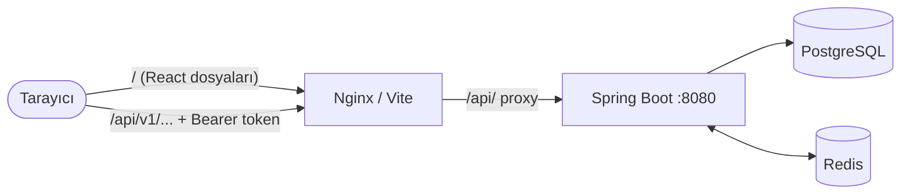
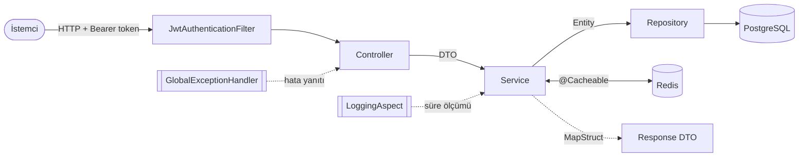
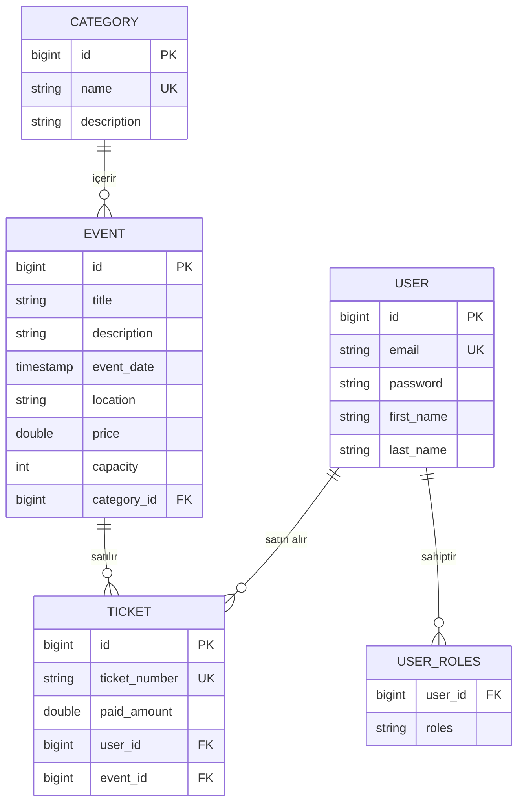

# EventifyPro

Etkinlik yönetimi için geliştirilmiş **full-stack** bir uygulama: **Spring Boot REST API** (backend) ve **React** arayüzü (frontend) aynı repoda, ayrı klasörlerde yaşar. Kullanıcılar kayıt olup JWT ile giriş yapar; etkinlikler kategorilere göre listelenir, aranır ve sayfalanır. Sık okunan etkinlik detayları Redis'te önbelleğe alınır. Frontend, backend, veritabanı ve önbellek tek bir `docker compose up` komutuyla ayağa kalkar.


---

## İçindekiler

- [Hızlı Başlangıç](#hızlı-başlangıç)
- [Önemli Linkler](#önemli-linkler)
- [Teknolojiler ve Neden Seçildiler](#teknolojiler-ve-neden-seçildiler)
- [Mimari](#mimari)
- [Veri Modeli](#veri-modeli)
- [API Uç Noktaları](#api-uç-noktaları)
- [Geliştirme Aşamaları](#geliştirme-aşamaları)
- [Proje Yapısı](#proje-yapısı)

---

## Hızlı Başlangıç

### Gereksinimler

- [Docker Desktop](https://www.docker.com/products/docker-desktop/) (Docker Compose dahil)
- Lokal geliştirme için ayrıca:
  - Backend: [JDK 21](https://adoptium.net/temurin/releases/?version=21) (Maven kurmanıza gerek yok, proje Maven Wrapper ile gelir)
  - Frontend: [Node.js 22](https://nodejs.org/) (npm ile birlikte gelir)

### 1. Ortam değişkenlerini hazırlayın

Şifreler ve JWT anahtarı kodda değil, git'e girmeyen bir `.env` dosyasında tutulur. Şablonu kopyalayın:

```bash
cp .env.example .env
```

Ardından `.env` içindeki `change-me` değerlerini doldurun. Güçlü bir JWT anahtarı üretmek için:

```bash
openssl rand -base64 64
```

### 2a. Her şeyi Docker ile çalıştırın (önerilen)

```bash
docker compose up -d --build
```

Bu komut sırasıyla PostgreSQL ve Redis'i başlatır, ikisi sağlıklı (*healthy*) olunca backend'i, backend sağlıklı olunca frontend'i ayağa kaldırır. Ardından tarayıcıda **http://localhost:3001** adresini açın. Durumu izlemek için:

```bash
docker compose ps
```

```bash
docker compose logs -f app
```

> Frontend portu 3001'dir. Bu port makinenizde doluysa `.env` dosyasına `FRONTEND_PORT=4000` gibi bir satır ekleyin.

### 2b. Geliştirme modunda çalıştırın (IDE / terminal)

Geliştirirken backend ve frontend'i ayrı ayrı, kendi araçlarıyla çalıştırmak daha pratiktir: kodu kaydettiğiniz anda sayfa yenilenir. Yalnızca veritabanı ve önbellek Docker'da kalır.

**Terminal 1: veritabanı ve önbellek**

```bash
docker compose up -d postgres redis
```

**Terminal 2: backend (8080)**

```bash
cd backend && ./mvnw spring-boot:run
```

**Terminal 3: frontend (5173)**

```bash
cd frontend && npm install && npm run dev
```

Tarayıcıda **http://localhost:5173** adresini açın.

> Backend `.env` dosyasını `spring.config.import` ile kendisi okur, IDE'de ek ayar gerekmez. IntelliJ'de projeyi `backend/pom.xml` üzerinden açın.
> Frontend'in `/api/...` istekleri Vite'ın geliştirme proxy'si ile 8080'e iletilir (bkz. `frontend/vite.config.ts`); bu sayede CORS ayarı gerekmez.
> Docker'daki `app` ve `frontend` container'ları çalışıyorsa önce `docker compose stop app frontend` ile durdurun, aksi halde 8080 portu çakışır.

### Durdurmak

```bash
docker compose down
```

Veritabanı verisini de silmek isterseniz `docker compose down -v` kullanın.

---

## Önemli Linkler

Uygulama çalışırken (API yolları `/api/v1` ön ekiyle başlar):

| Ne | Docker ile | Geliştirme modunda |
|---|---|---|
| **Web arayüzü** | http://localhost:3001 | http://localhost:5173 |
| Swagger UI (interaktif API dokümantasyonu) | http://localhost:8080/api/v1/swagger-ui/index.html | aynı |
| OpenAPI JSON | http://localhost:8080/api/v1/v3/api-docs | aynı |
| API kök adresi | http://localhost:8080/api/v1 | aynı |

---

## Teknolojiler ve Neden Seçildiler

| Teknoloji | Ne için | Neden |
|---|---|---|
| **Java 21** | Dil | Güncel LTS sürümü; `record`, `var`, pattern matching gibi modern özellikler. |
| **Spring Boot 4.1** | Uygulama çatısı | Otomatik yapılandırma ile REST, güvenlik, veri erişimi ve önbelleği az kodla bir araya getirir. |
| **Spring Data JPA + Hibernate** | Veri erişimi | Repository arayüzlerinden sorgular türetilir; ilişkiler entity'ler üzerinden yönetilir. |
| **PostgreSQL 15** | Kalıcı veritabanı | Güçlü, açık kaynak ve ilişkisel veriler (kullanıcı–bilet–etkinlik) için doğal seçim. |
| **Spring Security + JWT (jjwt)** | Kimlik doğrulama | Sunucuda oturum tutmayan (*stateless*) token tabanlı yapı; API'yi yatay ölçeklemeye uygun hale getirir. |
| **BCrypt** | Şifre saklama | Şifreler veritabanında asla açık metin olarak tutulmaz, tuzlanarak hash'lenir. |
| **Redis 7 + Spring Cache** | Önbellek | Sık okunan etkinlik detaylarını bellekte tutarak veritabanı yükünü azaltır. |
| **MapStruct** | Entity → DTO dönüşümü | Dönüşüm kodunu derleme sırasında üretir; reflection kullanmadığı için hızlıdır ve hataları derlemede yakalar. |
| **Lombok** | Tekrarlayan kod | Getter/setter, builder ve constructor'ları anotasyonlarla üretir. |
| **Bean Validation** | Girdi doğrulama | `@NotBlank`, `@Email`, `@Size` gibi kurallar DTO üzerinde tanımlanır, controller'a geçersiz veri girmez. |
| **Spring AOP (AspectJ)** | Kesişen ilgiler | Servis metotlarının çalışma süresi, iş koduna dokunmadan tek bir yerden loglanır. |
| **SpringDoc OpenAPI** | Dokümantasyon | Kod üzerinden otomatik Swagger dokümantasyonu üretir; API'yi tarayıcıdan denemeyi sağlar. |
| **RestClient** | Dış servis çağrısı | Spring'in modern, akıcı (*fluent*) HTTP istemcisi. |
| **React 19 + TypeScript** | Arayüz | Bileşen tabanlı, en yaygın kullanılan arayüz kütüphanesi; TypeScript ile backend DTO'ları tip güvenli şekilde eşlenir. |
| **Vite** | Frontend derleme ve geliştirme sunucusu | Anında yenilenen (*hot reload*) geliştirme deneyimi; geliştirme proxy'si CORS derdini ortadan kaldırır. |
| **Tailwind CSS 4** | Stil | Hazır yardımcı sınıflarla hızlı ve tutarlı tasarım; `@theme` ile proje renk paleti tek yerden tanımlanır. |
| **React Router** | Sayfa yönlendirme | Tek sayfa uygulamada (SPA) `/events/5` gibi yollar; korumalı rotalar giriş yapmayanı login'e yollar. |
| **Nginx** | Frontend'i sunma | Üretimde derlenmiş React dosyalarını verir ve `/api/` isteklerini backend container'ına iletir. |
| **Docker + Docker Compose** | Paketleme ve çalıştırma | Frontend, backend, veritabanı ve önbellek her makinede aynı şekilde, tek komutla çalışır. |

---

## Mimari

### Genel görünüm: frontend ve backend nasıl konuşur?

Frontend ve backend **iki ayrı program**dır; aralarındaki tek bağ HTTP'dir. Tarayıcı asla doğrudan `8080`'e gitmez: hem geliştirmede (Vite proxy) hem üretimde (Nginx) `/api/...` istekleri aynı adres üzerinden backend'e iletilir. Böylece tarayıcı tek bir site görür ve **CORS** hiç devreye girmez.



### Backend: katmanlı mimari

Backend klasik **katmanlı mimari** ile kurgulandı. Her katmanın tek bir sorumluluğu vardır:



- **Controller**: HTTP isteklerini karşılar, doğrulama (`@Valid`) yapar, yalnızca DTO döner.
- **Service**: İş kuralları burada; önbellek ve AOP de bu katmanda devreye girer.
- **Repository**: Spring Data JPA arayüzleri; özel sorgular JPQL ile yazıldı.
- **Entity'ler hiçbir zaman dışarıya açılmaz.** API yanıtları MapStruct ile DTO'ya çevrilir. Bu sayede veritabanı yapısı değişse bile API sözleşmesi korunur ve şifre gibi alanlar yanlışlıkla sızmaz.

### İstek akışı (kimlik doğrulama)

1. Kullanıcı `POST /auth/register` veya `POST /auth/login` ile bir **JWT** alır.
2. Sonraki isteklerde `Authorization: Bearer <token>` başlığını gönderir.
3. `JwtAuthenticationFilter` token'ı doğrular ve kullanıcıyı `SecurityContext`'e yerleştirir.
4. Token yoksa veya geçersizse korunan uç noktalar `403 Forbidden` döner.

### Frontend: yapı ve oturum yönetimi

- **`api/client.ts`** tüm isteklerin geçtiği tek kapıdır: temel adresi ekler, `localStorage`'daki token'ı `Authorization` başlığına koyar, backend'in `ErrorResponse` gövdesini okunabilir hata mesajına çevirir. 401/403 gelirse token'ı siler ve oturumu düşürür.
- **`context/AuthContext.tsx`** oturum durumunu uygulamanın her yerine dağıtır. Token tarayıcıda saklandığı için sayfa yenilense bile oturum kalır; süresi dolmuş token açılışta temizlenir.
- **Korumalı rotalar** (`RequireAuth`): giriş yapmamış kullanıcı `/events`'e gitmeye çalışırsa `/login`'e yönlendirilir, giriş yapınca kaldığı sayfaya döner.
- **Sayfalar**: `LoginPage`, `RegisterPage`, `EventsPage` (arama, sıralama, sayfalama, özet kartları) ve `EventDetailPage`.
- **Tasarım**: Preline tarzı açık tema; mavi ana renk, mor ve turkuaz vurgular. Renkler `index.css` içinde `@theme` ile tek yerden tanımlanır. Mobilde kenar çubuğu çekmeceye dönüşür.

---

## Veri Modeli

Tüm entity'ler `BaseEntity`'den türer: `id`, `createdAt` ve `updatedAt` alanları **JPA Auditing** (`@EnableJpaAuditing`) ile otomatik doldurulur.



**İlişki tasarımında alınan kararlar:**

- `Category → Event` ve `Event → Ticket` ilişkileri `cascade = ALL` ve `orphanRemoval = true` ile kuruldu: bir etkinlik silinince ona ait biletler de silinir, listeden çıkarılan bilet veritabanında sahipsiz kalmaz.
- `@ManyToOne` taraflarında `FetchType.LAZY` kullanıldı: bir bilet çekildiğinde etkinlik ve kullanıcı bilgisi ancak gerektiğinde yüklenir, gereksiz JOIN'ler önlenir.
- Roller (`ROLE_ADMIN`, `ROLE_ORGANIZER`, `ROLE_ATTENDEE`) bir `enum` olarak tutulur ve `@ElementCollection` ile ayrı `user_roles` tablosunda saklanır. Yeni kayıt olan kullanıcılar `ROLE_ATTENDEE` rolünü alır.

---

## API Uç Noktaları

Temel adres: `http://localhost:8080/api/v1`

### Kimlik doğrulama (herkese açık)

| Metot | Yol | Açıklama |
|---|---|---|
| `POST` | `/auth/register` | Yeni kullanıcı oluşturur, JWT döner |
| `POST` | `/auth/login` | E-posta ve şifre ile giriş yapar, JWT döner |

### Etkinlikler (token gerekir)

| Metot | Yol | Açıklama |
|---|---|---|
| `GET` | `/events?page=0&size=10&sort=eventDate,asc` | Tüm etkinlikleri sayfalı listeler |
| `GET` | `/events/{id}` | Etkinlik detayı (**Redis'te 10 dk önbelleklenir**) |
| `GET` | `/events/search?title=konser` | Başlığa göre büyük/küçük harf duyarsız arama |
| `GET` | `/events/category/{categoryId}` | Kategoriye göre listeleme (JPQL sorgusu) |

### Örnek kullanım

Kayıt olun ve token'ı alın:

```bash
curl -X POST http://localhost:8080/api/v1/auth/register \
  -H "Content-Type: application/json" \
  -d '{"email":"ayse@example.com","password":"gizli123","firstName":"Ayşe","lastName":"Yılmaz"}'
```

```json
{ "token": "eyJhbGciOiJIUzI1NiJ9..." }
```

Token ile etkinlikleri listeleyin:

```bash
curl http://localhost:8080/api/v1/events \
  -H "Authorization: Bearer <token>"
```

### Hata formatı

Tüm hatalar `GlobalExceptionHandler` tarafından aynı yapıda döndürülür, böylece istemci her hatayı tek bir şekilde işleyebilir:

```json
{
  "timestamp": "2026-11-18T22:15:04.123",
  "status": 400,
  "error": "Validation Error",
  "message": "{email=Lütfen geçerli bir e-posta adresi giriniz!}",
  "path": "/api/v1/auth/register"
}
```

---

## Geliştirme Aşamaları

Proje, her biri bir öncekinin üzerine kurulan 7 aşamada geliştirildi.

### Aşama 1: Proje Kurulumu ve Veritabanı Mimarisi

- Spring Initializr ile Maven projesi; Web, Data JPA, PostgreSQL, Lombok ve Validation bağımlılıkları.
- PostgreSQL ve Redis, Docker Compose ile ayağa kaldırıldı. Böylece kimsenin bilgisayarına veritabanı kurması gerekmiyor.
- `BaseEntity` ile tüm tablolara ortak `id`, `createdAt`, `updatedAt` alanları; JPA Auditing ile tarihlerin otomatik doldurulması.
- `controller`, `service`, `repository`, `entity`, `dto` paketleriyle katmanlı yapı.

### Aşama 2: Kullanıcı ve Yetkilendirme (Security & JWT)

- `User` entity'si doğrudan Spring Security'nin `UserDetails` arayüzünü uygular; e-posta, kullanıcı adı olarak kullanılır.
- `Role` enum'u ile rol tabanlı yetkilendirmeye hazır yapı.
- `JwtService` token üretir ve doğrular (HS256). `JwtAuthenticationFilter` her istekte token'ı okuyup `SecurityContext`'i doldurur.
- Oturum politikası `STATELESS`: sunucu hiçbir oturum bilgisi tutmaz.

### Aşama 3: Çekirdek İş Mantığı

- `Category`, `Event`, `Ticket` entity'leri ve aralarındaki One-to-Many / Many-to-One ilişkileri; cascade, orphan removal ve lazy fetch kullanımı.
- MapStruct ile entity → DTO dönüşümü (`EventMapper`, `CategoryMapper`). Örneğin `event.category.name` alanı, DTO'daki `categoryName` alanına otomatik eşlenir.
- `Pageable` ile sayfalama ve sıralama; JPQL ile kategoriye göre filtreleme, türetilmiş sorgu ile başlığa göre arama.

### Aşama 4: Gelişmiş Özellikler ve Hata Yönetimi

- `@RestControllerAdvice` ile merkezi hata yönetimi ve standart `ErrorResponse` yapısı.
- Validation hataları alan bazında yakalanıp anlaşılır mesajlarla döndürülür.
- Özel doğrulayıcı: `@ValidEventTitle` anotasyonu ve `EventTitleValidator`.
- `LoggingAspect`: `@Around` advice ile servis katmanındaki her metodun çalışma süresini ölçüp loglar. Performans ölçümü iş koduna tek satır eklenmeden yapılır.

### Aşama 5: Performans, Dış Servisler ve Dokümantasyon

- `@EnableCaching` ve `@Cacheable` ile etkinlik detayları Redis'te önbelleğe alınır (TTL: 10 dakika). İlk istekten sonra aynı etkinlik veritabanına gitmeden döner.
- `RedisTemplate` yapılandırması (`RedisConfig`).
- `ExternalLocationService`: `RestClient` ile dış bir API'den veri çekme altyapısı.
- SpringDoc ile otomatik Swagger dokümantasyonu.

### Aşama 6: Konteynerizasyon ve Canlıya Hazırlık

- **Çok aşamalı `Dockerfile`**: İlk aşama JDK ile jar'ı derler, ikinci aşama yalnızca JRE içeren küçük bir Alpine imajında çalıştırır. Derleme araçları son imaja girmez.
- Bağımlılıklar ayrı bir Docker katmanında indirilir: yalnızca kod değiştiğinde yeniden derleme çok daha hızlıdır.
- Uygulama container içinde **root olmayan** bir kullanıcıyla çalışır.
- `.dockerignore` ile `.env` ve derleme çıktıları imaja girmez.
- PostgreSQL ve Redis için `healthcheck`; uygulama ikisi de hazır olmadan başlamaz (`depends_on: service_healthy`).
- Gizli bilgiler (DB şifresi, JWT anahtarı) koddan çıkarılıp ortam değişkenlerine taşındı.

### Aşama 7: Frontend (React)

- Repo **monorepo** yapısına geçirildi: backend `backend/`, arayüz `frontend/` klasöründe.
- **Vite + React 19 + TypeScript + Tailwind CSS 4** ile arayüz: giriş, kayıt, etkinlik listesi (arama, sıralama, sayfalama) ve etkinlik detayı.
- JWT tabanlı oturum: token `localStorage`'da tutulur, her isteğe otomatik eklenir, korumalı rotalar giriş yapmayanı login'e yollar.
- Geliştirmede Vite proxy, üretimde Nginx `/api/` isteklerini backend'e iletir; CORS ayarına gerek kalmaz.
- Frontend için çok aşamalı `Dockerfile` (Node ile derleme → Nginx ile sunma) ve compose'a `frontend` servisi; backend `healthcheck` aldı, frontend onu bekler.

---

## Proje Yapısı

```
EventifyPro/
├── backend/                # Spring Boot REST API
│   ├── src/main/java/com/eventify/eventifypro/   (paketler aşağıda)
│   ├── pom.xml
│   └── Dockerfile          # JDK ile derle → JRE Alpine'da çalıştır
├── frontend/               # React + Vite + Tailwind arayüzü
│   ├── src/
│   │   ├── api/            # client.ts (tek HTTP kapısı), auth.ts, events.ts
│   │   ├── components/     # Layout (kenar çubuğu), EventCard, Pagination, ui
│   │   ├── context/        # AuthContext: oturum durumu
│   │   ├── hooks/          # useAuth
│   │   ├── lib/            # jwt.ts, format.ts (tarih/para biçimleme)
│   │   ├── pages/          # Login, Register, Events, EventDetail
│   │   └── types.ts        # Backend DTO'larının TS karşılıkları
│   ├── vite.config.ts      # geliştirme proxy'si (/api → 8080)
│   ├── nginx.conf          # üretim: statik dosyalar + /api proxy
│   └── Dockerfile          # Node ile derle → Nginx ile sun
├── docker-compose.yml      # frontend + app + postgres + redis
├── .env / .env.example
└── README.md
```

Backend paketleri:

```
backend/src/main/java/com/eventify/eventifypro
├── aop/            # LoggingAspect: metot çalışma süresi ölçümü
├── common/         # BaseEntity: ortak id ve audit alanları
├── config/         # RedisConfig: önbellek ve RedisTemplate ayarları
├── controller/     # REST uç noktaları (Auth, Event)
├── dto/            # İstek/yanıt nesneleri
├── entity/         # JPA entity'leri (User, Role, Category, Event, Ticket)
├── exception/      # GlobalExceptionHandler, ErrorResponse
├── mapper/         # MapStruct arayüzleri
├── repository/     # Spring Data JPA repository'leri
├── security/       # JWT servisi, filtre ve Security yapılandırması
├── service/        # İş mantığı arayüzleri ve dış servis istemcisi
│   └── impl/       # Servis implementasyonları
└── validation/     # Özel doğrulama anotasyonu ve doğrulayıcı
```

---
